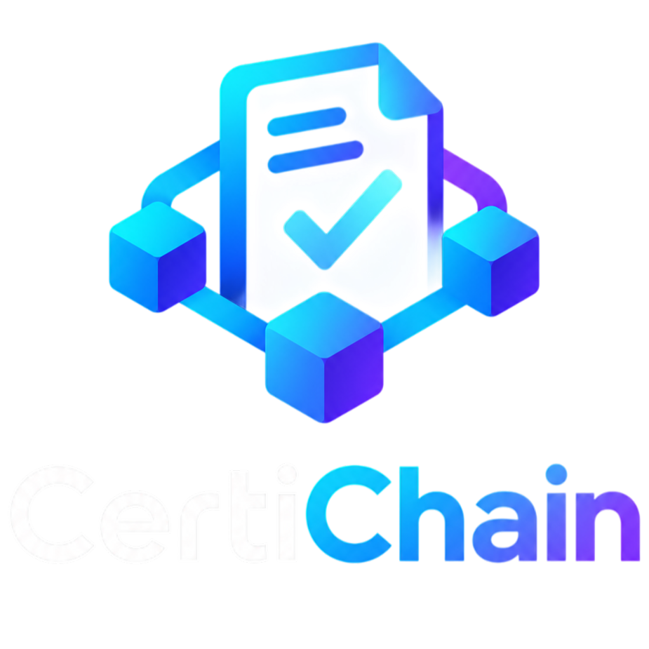
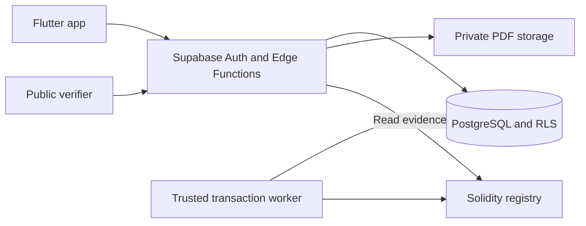

# CertiChain

<p align="center">
  
</p>

**Academic and professional certificates, with private documents and verifiable blockchain evidence.**

CertiChain is a final-year software engineering project (TFG) that implements the certificate lifecycle: an approved institution issues a PDF, its holder accesses and shares a verification link or QR code, and anyone can check the certificate's current status. Institutions can revoke certificates through an authenticated, auditable workflow.

The project combines a Flutter application, a Supabase backend and a Solidity registry. PDFs and personal data stay off-chain. The EVM registry stores opaque identifiers and a document commitment protected by a private salt; it never stores the PDF or its plain document hash.

## What you can explore

- **Institutional workflows:** membership-based access, validated PDF issuance, retry-safe operations, anchoring requests and irreversible revocation.
- **Certificate wallet:** authenticated access to certificates and private PDFs, public links and generated QR codes.
- **Public verification:** no account required; registry status, blockchain evidence and the integrity of a selected PDF are presented separately.
- **Failure recovery:** durable transaction attempts, nonce tracking, concurrent workers, lost responses, reorgs and explicit reauthorization.
- **Privacy boundaries:** Row Level Security, short-lived document URLs, restricted public responses and backend-only signing keys.

The application interface is currently in Spanish. This README is the English entry point; the documentation index identifies the engineering guides.

## Engineering approach

The main challenge is coordinating PostgreSQL and an EVM chain without pretending they share an atomic transaction. Certificate publication, SQL revocation, blockchain synchronization and document integrity each have explicit states. A failed or delayed blockchain transaction never makes a revoked certificate valid again.

Flutter uses feature-first modules and the dependency rule `presentation → domain ← data`. Domain code is independent of Flutter, Supabase and Web3. Privileged operations run in the backend; a separate trusted worker signs and reconciles EVM transactions.



## Technology

| Area | Implementation |
|---|---|
| Application | Flutter 3.47.4, Dart 3.13.3, Material UI, local Inter fonts |
| Backend | Supabase Auth, PostgreSQL, private Storage, TypeScript Edge Functions |
| Blockchain | Solidity 0.8.37, Foundry 1.8.5, OpenZeppelin Contracts 5.7.0, ethers 6.15.0 |
| Local EVM | Anvil; Sepolia configuration is specified but deployment is not validated |
| Test tooling | Flutter tests, pgTAP, Deno 2.2.12, Node.js 24.14.0, Chrome DevTools Protocol |
| CI | GitHub Actions: database permissions, Flutter/Android builds, contracts, anchoring and revocation |

Exact pins and checksums live in the [blockchain toolchain lock](blockchain/toolchain.lock.json), [Node version file](.node-version), Flutter lockfile and CI workflows.

## Run locally

### 1. Install the prerequisites

Use these versions to reproduce CI:

| Tool | Required setup |
|---|---|
| Flutter | **3.47.4**, revision `9584c6713b324636289d067944a46fd6b49df14b`; includes Dart **3.13.3** |
| [Node.js](https://nodejs.org/download/release/v24.14.0/) | **24.14.0**, with `node`, `npm` and `npx` using that installation |
| [Supabase CLI](https://github.com/supabase/cli/releases/tag/v2.117.0) | Standalone **2.117.0** binary on `PATH` |
| [Docker](https://docs.docker.com/desktop/) | Running with Linux containers |
| [PowerShell](https://github.com/PowerShell/PowerShell#get-powershell) | **7+** (`pwsh`), including on Linux for the local runner |
| Browser / utilities | Chrome or Chromium, Git, `tar` and OpenSSL; Git for Windows supplies the default Windows OpenSSL path |

Foundry, Solidity and contract dependencies are downloaded and checksum-verified by the repository's bootstrap script. A global Foundry installation is unnecessary. The supported bootstrap targets are Windows x64 and Linux x64.

See [development setup](docs/DEVELOPMENT.md) for installation details, configuration and troubleshooting.

### 2. Clone the repository

```sh
git clone https://github.com/benjvm/certichain.git
cd certichain
```

### 3. Run the complete local demonstration

From the repository root:

```sh
pwsh -NoProfile -File ./supabase/tests/run_phase10.ps1 -VisibleBrowser
```

The runner resolves frozen dependencies, builds the contracts and the real Flutter Web release, starts an isolated Supabase stack and Anvil, creates synthetic users and demonstrates issuance, verification and revocation in Chrome. It removes its own stack and temporary resources when finished. The browser is automated: watch the journey without interacting with it during the run.

This is a reproducible demonstration, not a persistent development server. It requires no real certificates, funded wallet or hosted Supabase project. To run without a visible browser, omit `-VisibleBrowser`; `-BackendOnly` tests the backend without validating the UI.

### 4. Start the app for development

For an interactive local session, start the repository's Supabase project from the root:

```sh
supabase start
supabase functions serve
```

Keep Functions running. In another terminal, use `supabase status` to obtain the local **anon/public client key**, then:

```sh
cd mobile
flutter pub get --enforce-lockfile
npm ci --ignore-scripts --prefix tool
node tool/prepare_decoder.mjs --check
flutter run -d chrome --web-hostname=localhost --web-port=7357 --dart-define=SUPABASE_URL=http://127.0.0.1:54321 --dart-define=SUPABASE_PUBLISHABLE_KEY=YOUR_LOCAL_ANON_KEY --dart-define=PUBLIC_VERIFICATION_BASE_URL=http://localhost:7357
```

Replace `YOUR_LOCAL_ANON_KEY` locally. Only public client configuration belongs in Dart defines; service-role and EVM signing keys stay in the backend.

A fresh stack has no preconfigured institution or shared login. Register users, then follow [institution provisioning](docs/INSTITUTION_ADMINISTRATION.md) to grant the required institutional access. Blockchain operations additionally require a live deployment, issuer configuration and the trusted worker described in [blockchain operations](docs/BLOCKCHAIN_OPERATIONS.md). The automated demonstration performs that setup for its temporary environment.

## Verification and current scope

The five CI workflows passed for commit [`3c892cd`](https://github.com/benjvm/certichain/commit/3c892cde3d0d21316089b2f8b6bb94702ca6f36a) on **30 October 2026**. The [complete revocation run](https://github.com/benjvm/certichain/actions/runs/41088795797) includes **978 SQL assertions, 272 backend tests, 266 Flutter tests and 183 browser assertions**; 12 Flutter tests were skipped. See the [acceptance record](docs/PHASE10_ACCEPTANCE.md) for exact scope and limitations.

The demonstrated target is Flutter Web in Chrome with local Supabase and Anvil. Android compilation is covered by CI, while full native acceptance, iOS, other browsers, hosted deployment and Sepolia finality remain unverified. Camera scenarios are intentionally skipped because no physical camera is available; static QR decoding, manual codes, links and PDF checks remain covered. Password recovery and self-service institutional onboarding remain outside the implemented flow.

The MVP has a shared public request budget suitable for local demonstration. Production abuse protection, key custody, retention policy and a human accessibility review require further work. Blockchain evidence proves registry facts and a document commitment; it does not establish academic truth or the identity of the person presenting a certificate.

## Repository and further reading

```text
mobile/        Flutter application and browser tools
supabase/      SQL migrations, RLS, Edge Functions, workers and integration tests
blockchain/    Solidity registry, Foundry tests and reproducible toolchain
docs/          Maintained contracts, architecture, operations and acceptance
```

- [Documentation index](docs/README.md)
- [Architecture](docs/ARCHITECTURE.md) and [Flutter boundaries](docs/FLUTTER_ARCHITECTURE.md)
- [Security and privacy](docs/SECURITY.md)
- [Testing guide](docs/TESTING.md) and [local demonstration](docs/DEMO_BLOCKCHAIN_LOCAL.md)
- [Architecture decisions](docs/ADR_README.md) and [remaining work](docs/ROADMAP.md)
