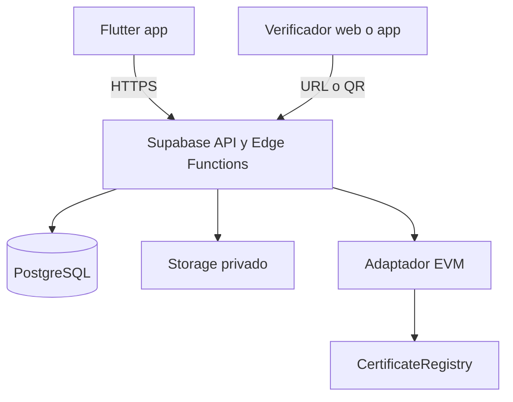
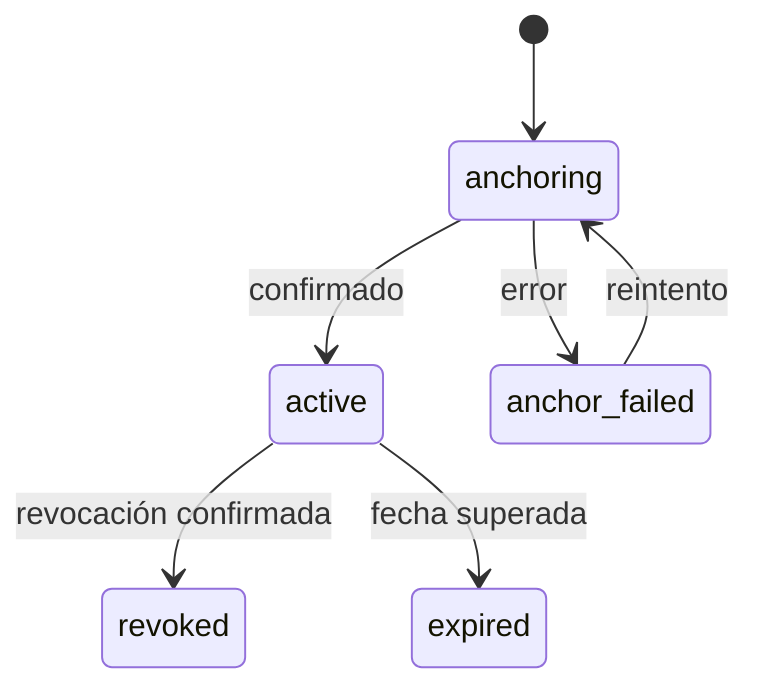

# Arquitectura

## Principios

1. El dominio define el producto; Supabase y EVM son adaptadores reemplazables.
2. Ningún secreto o privilegio administrativo reside en Flutter.
3. La base de datos es la fuente operativa; blockchain es la prueba externa de integridad y revocación.
4. Los procesos distribuidos usan estados explícitos e idempotencia, no una transacción ficticia entre PostgreSQL y blockchain.

## Contenedores



Flutter puede leer datos autorizados mediante repositorios respaldados por el SDK de Supabase. Emisión, revocación, hashing definitivo y escritura blockchain pasan por una Edge Function u otro backend confiable.

## Estructura Flutter

```text
mobile/lib/
├── app/                    # arranque, router, tema e inyección
├── core/                   # errores, utilidades y contratos compartidos
├── features/
│   ├── auth/
│   ├── certificates/
│   ├── issuance/
│   ├── verification/
│   ├── institutions/
│   └── profile/
└── main.dart
```

Cada feature puede contener:

```text
feature/
├── domain/
│   ├── entities/
│   ├── repositories/
│   └── usecases/
├── data/
│   ├── datasources/
│   ├── models/
│   └── repositories/
└── presentation/
    ├── pages/
    ├── controllers/
    └── widgets/
```

Regla de dependencias: `presentation → domain ← data`. El dominio no depende de las otras capas. `data` implementa interfaces definidas en `domain`.

## Contratos principales

- `AuthRepository`: sesión, registro y recuperación.
- `CertificateRepository`: consultas autorizadas y detalle.
- `IssuanceRepository`: solicitud y seguimiento de emisión.
- `VerificationRepository`: verificación pública por código o archivo.
- `InstitutionRepository`: perfil, miembros y estado.
- `BlockchainRegistry`: registrar, revocar y consultar una prueba.
- `DocumentStorage`: guardar, recuperar y eliminar documentos según política.

Los nombres representan responsabilidades; no obligan a crear una clase por método.

## Flujo de emisión

1. Flutter envía metadatos y PDF a una operación autenticada.
2. El backend verifica rol, institución aprobada, archivo y destinatario.
3. Almacena el PDF privado y calcula SHA-256 sobre los bytes almacenados.
4. Inserta el certificado con estado `anchoring` y una clave de idempotencia.
5. Registra la prueba en el contrato y conserva transacción, red y bloque.
6. Marca `active` cuando existe confirmación suficiente; ante fallo conserva `anchor_failed` para reintento controlado.

## Estados del certificado



`expired` puede ser derivado de `expires_at`; no necesita escribirse continuamente. La revocación requiere evidencia confirmada.

## Portabilidad futura

La primera migración prevista sería `Supabase SDK → API propia`, manteniendo casos de uso y entidades. Posteriormente, Auth y Storage pueden sustituirse detrás de adaptadores. Las dependencias específicas de Supabase se inventarían en ADR y en `docs/DATABASE.md`.
