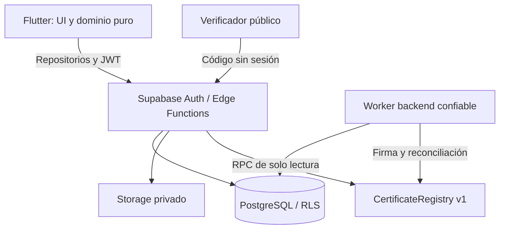

# Arquitectura

CertiChain separa identidad y gestión documental, decisiones operativas SQL y evidencia externa EVM. El MVP implementa emisión, verificación, apertura documental y revocación. [Estado y límites](PHASE10_ACCEPTANCE.md).

## Componentes y confianza



- Flutter y el navegador son clientes no confiables. El dominio define entidades/casos de uso y no importa Flutter, Supabase, PostgREST o Web3.
- UI accede a infraestructura mediante contratos propios. Identidad, sesión y generaciones invalidan respuestas privadas tardías.
- Edge vuelve a validar Auth, permisos y entradas; los RPC técnicos aplican invariantes transaccionales. `service_role` no sustituye autorización de negocio.
- El worker externo conserva secretos EVM y ledger durable. El lector público no firma, encola ni ejecuta el worker.
- PostgreSQL es la fuente operativa. No hay atomicidad PostgreSQL/Storage/EVM ni transacciones SQL abiertas durante RPC blockchain.

## Organización

```text
mobile/lib/
  app/                 Arranque, navegación, tema e inyección
  core/                Errores y capacidades compartidas
  features/
    auth/ certificates/ issuance/ verification/
    institutions/ profile/ revocation/
      domain/          Entidades, contratos y casos de uso Dart puros
      data/            SDK/HTTP, DTO, archivos y almacenamiento
      presentation/    Pantallas, controladores y widgets
supabase/
  migrations/          Esquema, RLS, funciones e invariantes versionadas
  functions/           Handlers y módulos de dominio/aplicación/infraestructura
  admin/               Operación confiable y worker
  tests/               SQL, HTTP, Anvil y aceptación
blockchain/            Contrato v1, herramientas aisladas y pruebas
```

Regla: `presentation → domain ← data`. Añadir únicamente las abstracciones necesarias para un caso de uso concreto. Detalle de composición y recursos en [FLUTTER_ARCHITECTURE](FLUTTER_ARCHITECTURE.md).

## Estados y recorridos

1. **Administración:** plataforma crea una institución pending con primer owner; solo plataforma decide su verificación. Las mutaciones autorizadas bloquean la fila padre y conservan al último owner. El registro ordinario no concede privilegios.
2. **Emisión:** sesión y membresía vigentes de institución verified; reserva idempotente; validación/almacenamiento/lectura del PDF y SHA-256; publicación SQL `active` y operación `completed`. Los datos publicados y bytes quedan inmutables.
3. **Anclaje:** solicitud explícita posterior a publicación crea identidad/compromiso privados. Worker reclama lease, firma y persiste intento antes de broadcast, luego contrasta receipt/evento/estado/bloque canónicos. Reintentos conservan identidad, salt y ledger.
4. **Verificación pública:** código → presupuesto global → snapshot SQL coherente → lectura EVM acotada. La app consume v3; v1/v2 y compare v1 conservan compatibilidad. Una caída RPC deja el registro y evidencia anterior fechada, no fabrica ausencia.
5. **Apertura documental:** endpoint Auth permite al titular propio o miembro autorizado obtener los datos mínimos para recalcular el compromiso localmente. No se publica hash/salt ni se sube el PDF comparado.
6. **Revocación:** owner/admin autorizado de emisora verified/suspended decide SQL irreversible inmediatamente. Se cancela issue sin firma o se conserva obligación de compensar un issue firmado/tardío. Worker sincroniza revoke; reorg/fallo EVM nunca restaura `active`.

La vigencia SQL, publicación documental, sincronización issue/revoke e integridad de una copia son juicios diferentes. Confirmado no equivale a finalidad PoS; Anvil indica `not_applicable`. Una coincidencia documental no anula expiración o revocación.

## Contratos y recuperación

`AuthRepository`, `CertificateRepository`, `InstitutionRepository`, `IssuanceRepository`, `AnchoringRepository`, `RevocationRepository`, `VerificationRepository` y capacidades de archivos/cámara separan producto de infraestructura. `BlockchainRegistry` es el puerto backend EVM, con DTO puros y adaptador independiente.

Conservar ledger íntegro de intentos/nonces, documentos, hash/salt y snapshots de deployment. Una cadena nueva o manifiesto histórico no sustituye el deployment original. Unknown/divergence no permite saltar nonces ni firmar a ciegas. Reautorizar exige revisión y permisos actuales.

Referencias: [seguridad](SECURITY.md), [datos](DATABASE.md), [emisión](SECURE_ISSUANCE.md), [revocación](REVOCATION.md), [operación EVM](BLOCKCHAIN_OPERATIONS.md), [protocolo normativo](PHASE9A_BLOCKCHAIN_SPEC.md) y [ADRs](ADR_README.md).
