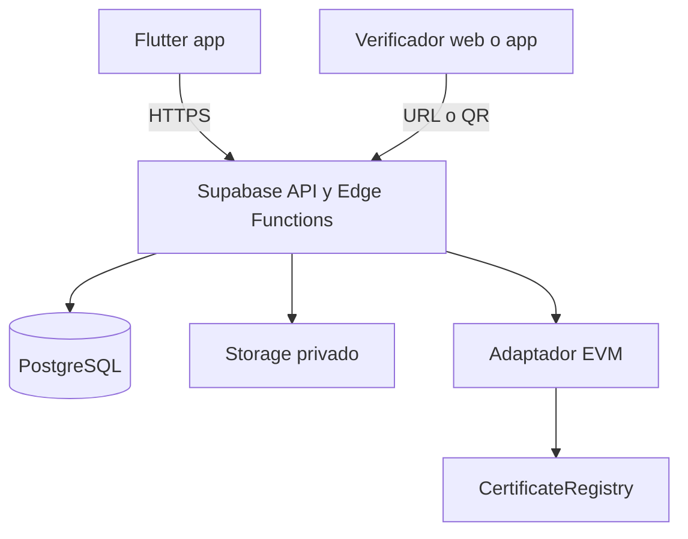
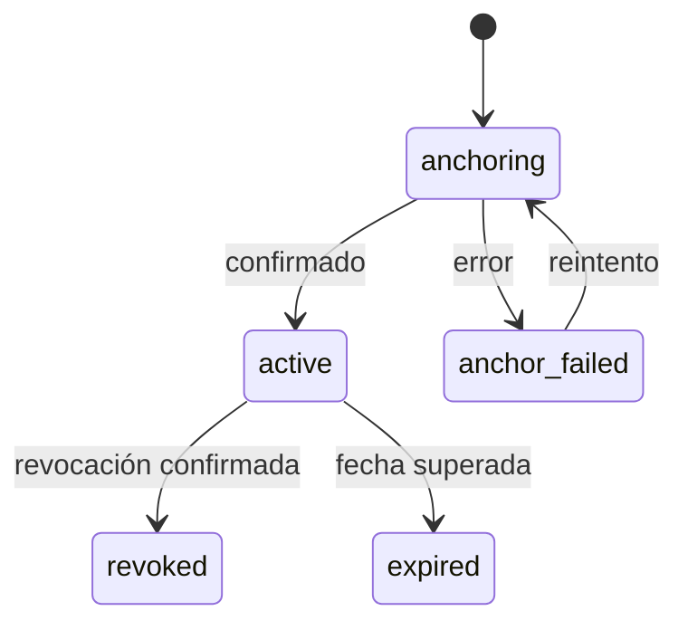

# Arquitectura

## Principios

1. El dominio define el producto; Supabase y EVM son adaptadores reemplazables.
2. Ningún secreto o privilegio administrativo reside en Flutter.
3. La base de datos es la fuente operativa; blockchain es la prueba externa de integridad y revocación.
4. Los procesos distribuidos usan estados explícitos e idempotencia, no una transacción ficticia entre PostgreSQL y blockchain.

## Contenedores



Flutter puede leer datos autorizados mediante repositorios respaldados por el SDK de Supabase. Emisión, revocación, hashing definitivo y escritura blockchain pasan por una Edge Function u otro backend confiable.

Tras Fase 5, la API de tablas de `certificates` solo permite SELECT autorizado
para `authenticated`; emisión y revocación directas no están habilitadas,
incluido para `platform_admin`. 7B implementa la Edge Function autenticada y
RPC técnicos de publicación; 7C añade cliente y acceso autorizado al PDF.
El [contrato vigente](SECURE_ISSUANCE.md) define sus controles. El nuevo flujo
de revocación y blockchain siguen pendientes.

Fase 6 resuelve administración institucional mediante operaciones SQL
transaccionales expuestas como RPC autenticados: alta pending con primer owner,
datos, estados y miembros. Sus funciones verifican auth.uid() y autorización
en BD y sustituyen el DML institucional directo. La aprobación corresponde a
plataforma; owner gestiona miembros y admin institucional edita datos. La
escritura de la fila institucional serializa los cambios y protege último owner,
también en cascadas de Auth. DELETE institucional se cierra para conservar historial.
Bootstrap y altas adicionales de plataforma requieren SQL operativo confiable;
no son RPC públicos ni actualizaciones ordinarias de perfil.
Decisión: [ADR-0007](adr/0007-managed-institution-administration.md).
La Fase 7 entrega emisión segura sin blockchain con backend, PDF privado, SHA-256
e idempotencia; los RPC de fase 6 no escriben certificados ni implementan PDF.

## Estructura Flutter

```text
mobile/lib/
├── app/                    # arranque, router, tema e inyección
├── core/                   # errores, utilidades y contratos compartidos
├── features/
│   ├── auth/
│   ├── certificates/
│   ├── issuance/
│   ├── verification/
│   ├── institutions/
│   └── profile/
└── main.dart
```

Cada feature puede contener:

```text
feature/
├── domain/
│   ├── entities/
│   ├── repositories/
│   └── usecases/
├── data/
│   ├── datasources/
│   ├── models/
│   └── repositories/
└── presentation/
    ├── pages/
    ├── controllers/
    └── widgets/
```

Regla de dependencias: `presentation → domain ← data`. El dominio no depende de las otras capas. `data` implementa interfaces definidas en `domain`.

## Contratos principales

- `AuthRepository`: sesión, registro y recuperación.
- `CertificateRepository`: consultas autorizadas y detalle.
- `IssuanceRepository`: solicitud y seguimiento de emisión.
- `VerificationRepository`: verificación pública por código o archivo.
- `InstitutionRepository`: perfil, miembros y estado.
- `BlockchainRegistry`: registrar, revocar y consultar una prueba.
- `DocumentStorage`: guardar, recuperar y eliminar documentos según política.

Los nombres representan responsabilidades; no obligan a crear una clase por método.

## Flujo de emisión vigente sin blockchain

7A–7D implementan emisión segura sin blockchain: autorización de sesión y
membresía, `verification_status = 'verified'` al persistir, destinatario válido,
PDF validado/privado, SHA-256 de sus bytes finales e idempotencia durable con
recuperación ante fallos de Storage/base de datos. Publica estado `active` y
conserva inmutables sus datos finales. Reserva y publicación transaccionales
rodean las operaciones Storage; véase [SECURE_ISSUANCE.md](SECURE_ISSUANCE.md).

## Backend público 8A

Verificador sin sesión → POST verify-certificate → consumo de presupuesto
compartido en PostgreSQL → entrada JSON cerrada → lookup_public_certificate.
Solo el backend posee service_role; ambos RPC técnicos tienen EXECUTE exclusivo.
La consulta enlaza certificado/operación completed/institución y proyecta campos
públicos. Un instante servidor evalúa resultados. No accede a Auth, membresías
del verificador ni Storage; no descarga ni compara PDFs por petición.

El limitador serializa una fila privada, usa reloj servidor tras el lock y no
depende de cabeceras o IP. El backend consume antes de validar para cubrir los
POST desconocidos/inválidos y falla cerrado ante problemas de infraestructura.
No hay cambios Flutter en 8A. Contrato y límites:
[PUBLIC_VERIFICATION.md](PUBLIC_VERIFICATION.md), [ADR-0011](adr/0011-public-registry-verification.md).

El flujo posterior con blockchain será:

1. Flutter envía metadatos y PDF a una operación autenticada.
2. El backend verifica rol, institución aprobada, archivo y destinatario.
3. Almacena el PDF privado y calcula SHA-256 sobre los bytes almacenados.
4. Inserta el certificado con estado `anchoring` y una clave de idempotencia.
5. Registra la prueba en el contrato y conserva transacción, red y bloque.
6. Marca `active` cuando existe confirmación suficiente; ante fallo conserva `anchor_failed` para reintento controlado.

## Estados futuros con blockchain (no implementados)

El enum actual solo admite `active`/`revoked`; `expired` se deriva de la fecha
en Flutter. `anchoring` y `anchor_failed` requieren migraciones posteriores.
La revocación será una operación de backend autorizada, idempotente y
sincronizada con el registro blockchain; el trigger actual no implementa ese flujo.



`expired` puede ser derivado de `expires_at`; no necesita escribirse continuamente. La revocación requiere evidencia confirmada.

## Portabilidad futura

La primera migración prevista sería `Supabase SDK → API propia`, manteniendo casos de uso y entidades. Posteriormente, Auth y Storage pueden sustituirse detrás de adaptadores. Las dependencias específicas de Supabase se inventarían en ADR y en `docs/DATABASE.md`.
