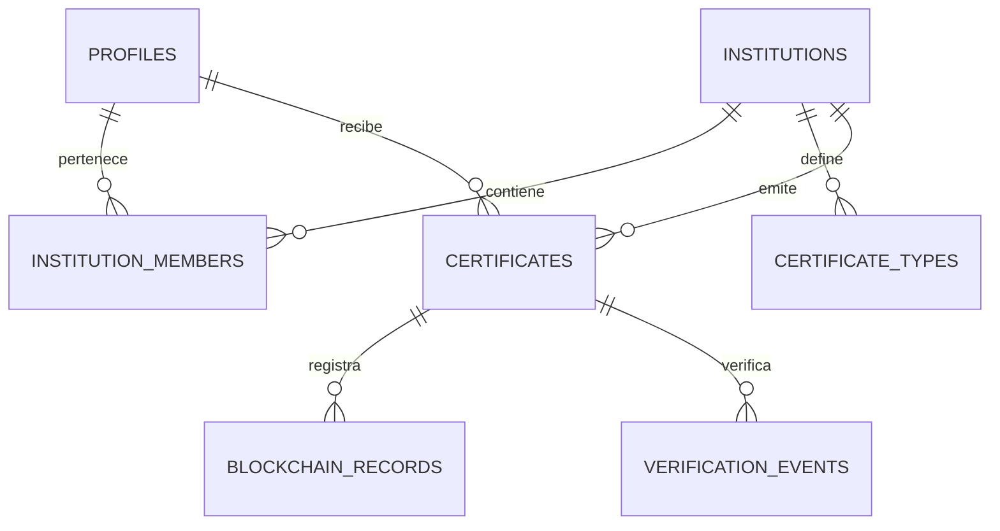

# Modelo de datos y migraciones

La primera migración, `initial_schema`, define cuatro tablas: `profiles`,
`institutions`, `institution_members` y `certificates`. Los campos y tablas
adicionales descritos más abajo son propuestas para incrementos futuros, no
parte del esquema inicial. La primera migración habilitó RLS; la segunda,
`rls_policies`, define las políticas para `authenticated`. `anon` no tiene
acceso directo a ninguna de las cuatro tablas.
Los certificados conservan referencias obligatorias; por ello se impide borrar
un perfil o institución que tenga certificados asociados. Esta decisión también
puede impedir borrar un usuario de `auth.users`, porque su perfil se eliminaría
en cascada. Una futura política de eliminación o anonimización debe resolver
explícitamente ese caso sin perder el historial.

## Fuente de verdad

El esquema se define exclusivamente en `supabase/migrations/`. El panel visual sirve para inspección, nunca para realizar cambios no versionados.

Crear una migración:

```bash
supabase migration new create_initial_schema
```

Aplicar localmente:

```bash
supabase start
supabase db reset
```

El nombre real llevará timestamp, por ejemplo `20260918190000_create_initial_schema.sql`. Una migración compartida no se reescribe; la corrección se hace en una migración posterior.

## Contrato real consumido por Flutter — Fases 4C y 4D

Las migraciones vigentes definen `profiles(id, full_name, role, created_at,
updated_at)` y `certificates` con `holder_id` (no `recipient_id`),
`institution_id`, `title`, `issued_at`, `expires_at` y `status` limitado a
`active`/`revoked`. El estado de la institución se llama `verification_status`
y admite `pending`, `verified`, `rejected`, `suspended`.

La wallet filtra por `holder_id`, limita a 50 registros y obtiene el total exacto.
La relación `institutions(name)` es opcional por RLS: el titular de un certificado
no obtiene por ello permiso para leer su emisor. No se cambian políticas en 4C.
La emisión autorizada por la RLS actual **no comprueba aprobación institucional**;
resolverlo corresponde a una fase futura. Véase [STUDENT_WALLET.md](STUDENT_WALLET.md).

En 4D, el detalle usa la misma selección mínima de columnas de la wallet y
`institutions(name)`, con `id = certificateId` y `holder_id = userId`, mediante
`maybeSingle()`. Una fila ausente o invisible por RLS se representa con el mismo
mensaje. Se rechaza una identidad de certificado o titular inesperada. No se
leen `document_path`, `document_hash`, `credential_code` ni datos blockchain;
no se añaden migraciones, funciones, grants ni políticas.

## Modelo futuro propuesto (no es el contrato vigente)

### `profiles`

| Columna | Tipo | Regla |
|---|---|---|
| id | uuid | PK y FK a `auth.users(id)` |
| full_name | text | obligatorio |
| avatar_path | text | opcional |
| created_at | timestamptz | default `now()` |
| updated_at | timestamptz | actualizado por trigger |

El correo y la contraseña no se duplican aquí.

### `institutions`

| Columna | Tipo | Regla |
|---|---|---|
| id | uuid | PK, default UUID aleatorio |
| name | text | obligatorio |
| slug | text | unique |
| website | text | opcional |
| logo_path | text | opcional |
| status | text | check: pending/approved/suspended/rejected |
| created_at | timestamptz | default `now()` |
| updated_at | timestamptz | default `now()` |

### `institution_members`

| Columna | Tipo | Regla |
|---|---|---|
| institution_id | uuid | FK, parte de PK compuesta |
| user_id | uuid | FK a `profiles`, parte de PK |
| role | text | check: owner/issuer/viewer |
| created_at | timestamptz | default `now()` |

La pertenencia sustituye un único `role` global y permite que una persona participe en varias instituciones.

### `certificate_types`

| Columna | Tipo | Regla |
|---|---|---|
| id | uuid | PK |
| institution_id | uuid | FK |
| name | text | obligatorio |
| description | text | opcional |
| active | boolean | default true |

Unique recomendado: `(institution_id, lower(name))` mediante índice de expresión.

### `certificates`

| Columna | Tipo | Regla |
|---|---|---|
| id | uuid | PK interno |
| public_id | uuid | unique, usado por QR |
| institution_id | uuid | FK obligatoria |
| recipient_id | uuid | FK a `profiles` |
| certificate_type_id | uuid | FK opcional |
| title | text | obligatorio |
| description | text | opcional |
| issued_at | timestamptz | obligatorio |
| expires_at | timestamptz | opcional, posterior a emisión |
| document_path | text | obligatorio y privado |
| document_sha256 | bytea | exactamente 32 bytes |
| status | text | anchoring/active/anchor_failed/revoking/revoked |
| idempotency_key | uuid | unique |
| created_by | uuid | FK a `profiles` |
| created_at | timestamptz | default `now()` |
| updated_at | timestamptz | default `now()` |

Los metadatos que deben quedar congelados después de emitir se validan mediante permisos y trigger. No se permite sustituir silenciosamente el PDF.

### `blockchain_records`

| Columna | Tipo | Regla |
|---|---|---|
| id | uuid | PK |
| certificate_id | uuid | FK |
| operation | text | issue/revoke |
| network | text | identificador de red |
| chain_id | bigint | obligatorio |
| contract_address | text | obligatorio |
| transaction_hash | text | unique |
| block_number | bigint | opcional hasta confirmar |
| payload_hash | bytea | 32 bytes |
| status | text | pending/confirmed/failed |
| error_code | text | opcional, sin secretos |
| created_at | timestamptz | default `now()` |
| confirmed_at | timestamptz | opcional |

### `verification_events`

| Columna | Tipo | Regla |
|---|---|---|
| id | bigint identity | PK |
| certificate_id | uuid | FK opcional para not_found seguro |
| result | text | conjunto cerrado de resultados |
| method | text | qr/code/file |
| request_fingerprint | text | opcional, seudonimizado y con retención |
| created_at | timestamptz | default `now()` |

Esta tabla es opcional para el primer incremento. No almacenar IP sin justificación y política de retención.

## Relaciones



## Índices mínimos

- `certificates(recipient_id, created_at desc)`.
- `certificates(institution_id, created_at desc)`.
- Unique `certificates(public_id)` e `idempotency_key`.
- `blockchain_records(certificate_id, operation, created_at desc)`.
- Unique `blockchain_records(chain_id, transaction_hash)`.
- `verification_events(certificate_id, created_at desc)` si se activa historial.

## RLS vigente

La identidad se obtiene de `auth.uid()`. El rol global `platform_admin` permite
las operaciones administrativas expresamente indicadas abajo. `holder` e
`institution_admin` no confieren por sí solos permisos sobre instituciones:
estos dependen de `institution_members.role` (`owner`, `admin` o `issuer`).

| Tabla | Lectura | Escritura desde `authenticated` |
|---|---|---|
| `profiles` | Perfil propio o cualquier perfil para `platform_admin` | Actualización propia sin cambiar `role`; `platform_admin` puede actualizar perfiles. Sin INSERT ni DELETE de cliente. |
| `institutions` | Miembros y `platform_admin` | INSERT/DELETE solo `platform_admin`; UPDATE `owner`, `admin` o `platform_admin`. Solo `platform_admin` cambia `verification_status`. |
| `institution_members` | Fila propia; todas las filas de la institución para `owner`/`admin`; todas para `platform_admin` | INSERT/UPDATE/DELETE solo `owner` de esa institución o `platform_admin`. |
| `certificates` | Titular, cualquier miembro de la institución emisora o `platform_admin` | INSERT por `owner`/`admin`/`issuer` de la institución con `issued_by = auth.uid()`, o por `platform_admin`. UPDATE por `owner`/`admin` solo para revocar, o por `platform_admin`. Sin DELETE de cliente. |

Las funciones `certichain_private.is_platform_admin`,
`is_institution_member` y `has_institution_role` consultan únicamente el estado
de autorización del usuario actual. Son `SECURITY DEFINER`, usan un
`search_path` vacío y evitan recursión RLS. El esquema no está expuesto por la
API; solo `authenticated` puede ejecutarlas. Los triggers de `profiles` e
`institutions` impiden cambiar roles globales o estados de verificación sin
ser `platform_admin`. El trigger de `certificates` limita a los administradores
institucionales a la transición `active → revoked`, conserva todos los demás
campos y fija `revoked_at` con la hora de la base de datos.

No hay acceso directo para `anon`; la verificación pública requiere una futura
interfaz restringida. Tampoco hay una política de INSERT para perfiles: el
aprovisionamiento inicial usa el trigger descrito abajo; la asignación del primer
`platform_admin` sigue requiriendo un flujo confiable futuro. La migración no garantiza que permanezca al menos un
`owner` por institución; se necesita una regla transaccional de negocio para
evitar borrar o degradar al último. La emisión directa autorizada por RLS no
valida aún el archivo ni su hash: antes de producción, ese flujo debe pasar por
el backend confiable descrito en `docs/ARCHITECTURE.md`.

## Aprovisionamiento confiable de perfiles — Phase 4A

La migración `20260921154627_trusted_profile_provisioning.sql` incorpora este
flujo dentro de la misma transacción:

```text
INSERT auth.users
  → certichain_auth_user_provision_profile (AFTER INSERT, FOR EACH ROW)
  → certichain_private.provision_auth_user_profile()
  → INSERT public.profiles (id = NEW.id, full_name validado, role = holder)
```

El perfil se crea cuando se inserta la identidad, no cuando se confirma el correo.
La PK de `profiles` garantiza un único perfil por identidad. No hay upsert, RPC
público ni sincronización posterior desde los metadatos de Auth. Este incremento
no rellena perfiles ausentes de identidades anteriores.

### Contrato de entrada y errores

El registro debe proporcionar `full_name` como **string JSON** en los metadatos
de usuario de Supabase Auth (`raw_user_meta_data.full_name`; en el SDK corresponde
a `options.data.full_name`). El trigger elimina espacios en los extremos según
la clase PostgreSQL `[[:space:]]`, incluidos tabuladores y saltos de línea, y
conserva el contenido interior. Es entrada no confiable que se valida, no una
fuente de autorización.

Si falta el nombre, es null, tiene otro tipo JSON o queda vacío al recortarlo,
la función lanza SQLSTATE `23514` con un mensaje fijo sin datos personales.
La transacción revierte tanto la identidad como el perfil; Auth puede presentar
un error genérico de creación de usuario. No se sustituye el nombre por correo,
UUID ni datos inventados. Las altas por otros proveedores o herramientas también
deben cumplir este contrato. La traducción del error a UI pertenece a Phase 4B.

`profiles_full_name_not_blank` aplica la misma regla a cualquier INSERT/UPDATE
del perfil, además del `NOT NULL` existente. Antes de añadirla, la migración
comprueba los perfiles existentes: si encuentra nombres en blanco, se detiene
con un error que exige revisión y corrección explícitas. No modifica datos ni
incluye sus valores en ese mensaje. No se ha inspeccionado ningún proyecto remoto;
la compatibilidad de sus datos debe comprobarse antes de una futura aplicación.

### Autorización

Todos los registros propios comienzan explícitamente como `holder`, incluidos
los que seleccionen «Institución». «Estudiante»/«Institución» expresa intención
de presentación y no se persiste aquí. Los metadatos de rol, institución o
membresía se ignoran: no se crean instituciones ni filas en `institution_members`,
ni se conceden `institution_admin`, `platform_admin`, `owner`, `admin` o `issuer`.
El onboarding institucional y su aprobación siguen pendientes.

La función reside en el esquema privado ya existente, es `SECURITY DEFINER`,
usa `search_path = ''` y referencias a objetos cualificadas. Su propietario es
el propietario confiable de las migraciones/tablas, como las funciones privadas
existentes; esto permite insertar pese a RLS desde el trigger de Auth. No se
añaden roles ni grants de tabla. Se revoca EXECUTE de PUBLIC, `anon`,
`authenticated` y `service_role`; la función no es una operación de cliente.
Su cuerpo fijo solo valida el nombre e inserta el perfil, sin SQL dinámico.

INSERT de cliente permanece deshabilitado para evitar perfiles arbitrarios o
roles elegidos por el usuario. Las políticas SELECT/UPDATE y el trigger que
protege los cambios de rol no se alteran. La elevación administrativa queda
fuera de este incremento.

### Pruebas locales

Desde la raíz, con Supabase CLI y Docker disponibles:

```bash
supabase start
supabase db reset --local
supabase test db --local
supabase db lint --local --level warning
```

Si la CLI se usa mediante npm, anteponer `npx --yes` a cada comando. No usar
`--linked` ni una URL remota para estas pruebas.

`supabase/tests/profile_provisioning.test.sql` usa pgTAP sobre las tablas y el
trigger reales. Comprueba el rol de base de datos de Auth, identidad, unicidad,
recorte, rol inicial, metadatos maliciosos, tipos/nombres inválidos, rollback,
permisos de función y regresiones RLS de lectura, actualización e INSERT.
Todos los fixtures son sintéticos y se revierten al terminar. Son pruebas de
integración de base de datos, no del endpoint HTTP de signup ni del correo.
El enfoque sigue la [documentación de pruebas de Supabase](https://supabase.com/docs/guides/database/testing)
y su [ciclo de creación de perfiles con triggers](https://supabase.com/docs/guides/auth/managing-user-data).

## Seeds

`supabase/seed.sql` solo contendrá instituciones, perfiles y certificados ficticios para desarrollo. Debe ser determinista, repetible y no depender de información personal real.
