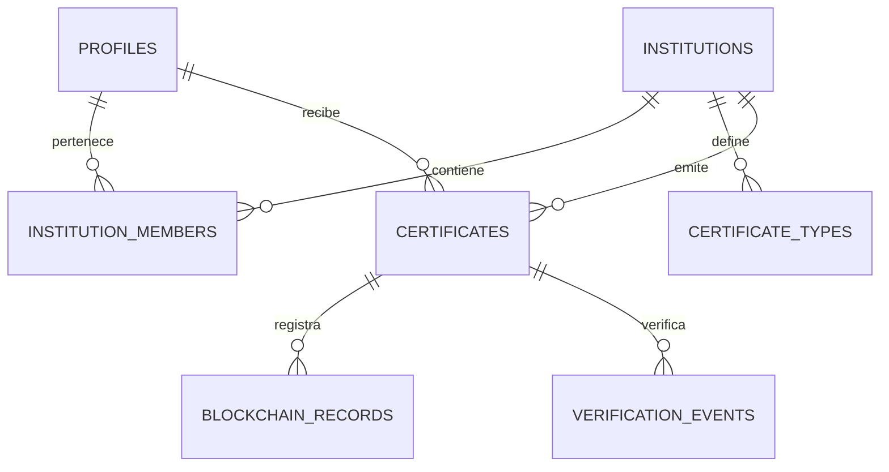

# Modelo de datos y migraciones

## Fuente de verdad

El esquema se define exclusivamente en `supabase/migrations/`. El panel visual sirve para inspección, nunca para realizar cambios no versionados.

Crear una migración:

```bash
supabase migration new create_initial_schema
```

Aplicar localmente:

```bash
supabase start
supabase db reset
```

El nombre real llevará timestamp, por ejemplo `20260918190000_create_initial_schema.sql`. Una migración compartida no se reescribe; la corrección se hace en una migración posterior.

## Modelo inicial propuesto

### `profiles`

| Columna | Tipo | Regla |
|---|---|---|
| id | uuid | PK y FK a `auth.users(id)` |
| full_name | text | obligatorio |
| avatar_path | text | opcional |
| created_at | timestamptz | default `now()` |
| updated_at | timestamptz | actualizado por trigger |

El correo y la contraseña no se duplican aquí.

### `institutions`

| Columna | Tipo | Regla |
|---|---|---|
| id | uuid | PK, default UUID aleatorio |
| name | text | obligatorio |
| slug | text | unique |
| website | text | opcional |
| logo_path | text | opcional |
| status | text | check: pending/approved/suspended/rejected |
| created_at | timestamptz | default `now()` |
| updated_at | timestamptz | default `now()` |

### `institution_members`

| Columna | Tipo | Regla |
|---|---|---|
| institution_id | uuid | FK, parte de PK compuesta |
| user_id | uuid | FK a `profiles`, parte de PK |
| role | text | check: owner/issuer/viewer |
| created_at | timestamptz | default `now()` |

La pertenencia sustituye un único `role` global y permite que una persona participe en varias instituciones.

### `certificate_types`

| Columna | Tipo | Regla |
|---|---|---|
| id | uuid | PK |
| institution_id | uuid | FK |
| name | text | obligatorio |
| description | text | opcional |
| active | boolean | default true |

Unique recomendado: `(institution_id, lower(name))` mediante índice de expresión.

### `certificates`

| Columna | Tipo | Regla |
|---|---|---|
| id | uuid | PK interno |
| public_id | uuid | unique, usado por QR |
| institution_id | uuid | FK obligatoria |
| recipient_id | uuid | FK a `profiles` |
| certificate_type_id | uuid | FK opcional |
| title | text | obligatorio |
| description | text | opcional |
| issued_at | timestamptz | obligatorio |
| expires_at | timestamptz | opcional, posterior a emisión |
| document_path | text | obligatorio y privado |
| document_sha256 | bytea | exactamente 32 bytes |
| status | text | anchoring/active/anchor_failed/revoking/revoked |
| idempotency_key | uuid | unique |
| created_by | uuid | FK a `profiles` |
| created_at | timestamptz | default `now()` |
| updated_at | timestamptz | default `now()` |

Los metadatos que deben quedar congelados después de emitir se validan mediante permisos y trigger. No se permite sustituir silenciosamente el PDF.

### `blockchain_records`

| Columna | Tipo | Regla |
|---|---|---|
| id | uuid | PK |
| certificate_id | uuid | FK |
| operation | text | issue/revoke |
| network | text | identificador de red |
| chain_id | bigint | obligatorio |
| contract_address | text | obligatorio |
| transaction_hash | text | unique |
| block_number | bigint | opcional hasta confirmar |
| payload_hash | bytea | 32 bytes |
| status | text | pending/confirmed/failed |
| error_code | text | opcional, sin secretos |
| created_at | timestamptz | default `now()` |
| confirmed_at | timestamptz | opcional |

### `verification_events`

| Columna | Tipo | Regla |
|---|---|---|
| id | bigint identity | PK |
| certificate_id | uuid | FK opcional para not_found seguro |
| result | text | conjunto cerrado de resultados |
| method | text | qr/code/file |
| request_fingerprint | text | opcional, seudonimizado y con retención |
| created_at | timestamptz | default `now()` |

Esta tabla es opcional para el primer incremento. No almacenar IP sin justificación y política de retención.

## Relaciones



## Índices mínimos

- `certificates(recipient_id, created_at desc)`.
- `certificates(institution_id, created_at desc)`.
- Unique `certificates(public_id)` e `idempotency_key`.
- `blockchain_records(certificate_id, operation, created_at desc)`.
- Unique `blockchain_records(chain_id, transaction_hash)`.
- `verification_events(certificate_id, created_at desc)` si se activa historial.

## RLS resumida

- `profiles`: cada usuario lee y actualiza el suyo; exposición adicional mediante vistas/control backend.
- `institutions`: lectura pública solo de campos seguros; cambios administrativos restringidos.
- `institution_members`: miembros leen su institución; solo owner/admin gestiona miembros.
- `certificates`: estudiante lee los suyos; miembros leen los de su institución; creación/revocación solo mediante operación segura.
- `blockchain_records`: lectura relacionada autorizada; escritura exclusiva del backend.
- Verificación pública: usar una función/vista que devuelva un DTO mínimo, no `SELECT` público sobre `certificates`.

Cada migración debe incluir RLS y políticas de las tablas nuevas en el mismo incremento, además de pruebas de permisos.

## Seeds

`supabase/seed.sql` solo contendrá instituciones, perfiles y certificados ficticios para desarrollo. Debe ser determinista, repetible y no depender de información personal real.
