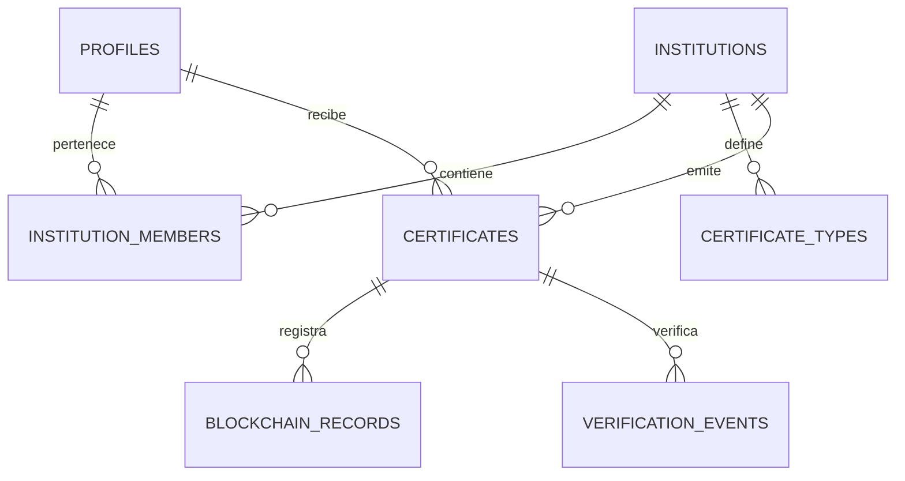

# Modelo de datos y migraciones

La primera migración, `initial_schema`, define cuatro tablas: `profiles`,
`institutions`, `institution_members` y `certificates`. La Fase 7A añade
`certificate_issuance_operations`. Otras tablas descritas más abajo son
propuestas para incrementos futuros. La primera migración habilitó RLS; la segunda,
`rls_policies`, define las políticas para `authenticated`. La Fase 5 añade
`close_direct_certificate_writes` para retirar escrituras de certificados y
grants administrativos sobrantes. `anon` no puede obtener filas de ninguna
de las cuatro tablas: certificados deniega por grants; las otras, por RLS.
La Fase 6 añade `institution_administration`: alta administrada atómica,
RPC estrechos, bootstrap SQL confiable y protección transaccional de propietarios.
Retira las políticas/grants DML institucionales históricos y conserva SELECT.
Los certificados conservan referencias obligatorias; por ello se impide borrar
un perfil o institución que tenga certificados asociados. Esta decisión también
puede impedir borrar un usuario de `auth.users`, porque su perfil se eliminaría
en cascada. Una futura política de eliminación o anonimización debe resolver
explícitamente ese caso sin perder el historial.

## Fuente de verdad

El esquema se define exclusivamente en `supabase/migrations/`. El panel visual sirve para inspección, nunca para realizar cambios no versionados.

## Incremento 7A: integridad y reserva de emisión

La migración `20260930120000_prepare_private_issuance.sql` añade
`certificate_issuance_operations` y el vínculo nullable
`certificates.issuance_operation_id`. El contrato real conserva `holder_id`,
`issued_by`, `credential_code`, `document_path` y `document_hash` como text y
`active`/`revoked`. Para un certificado ligado a operación, `document_hash`
debe ser exactamente SHA-256 hexadecimal minúsculo de 64 caracteres y
`document_path` es `<institution_id>/<certificate_id>.pdf`. Las FK compuestas
coinciden en operación, certificado objetivo, institución, actor, titular y
hash final; la operación completada apunta de vuelta al mismo certificado.
Los triggers congelan la identidad de la reserva, el resultado completado y
los campos emitidos del certificado. Solo quedan posibles transiciones futuras
de estado/revocación por backend autorizado.

Las filas históricas tienen `issuance_operation_id = NULL` y quedan exentas
de las nuevas comprobaciones de PDF/hash; no se alteran ni se les atribuye
un archivo. Una actualización o revocación futura de una fila antigua no
activa la nueva constraint. Cualquier hash/ruta histórica de formato desconocido
requiere revisión antes de migrarla a un flujo nuevo; no se corrige
silenciosamente. Nuevas emisiones de 7B deben crear y vincular una operación.
La tabla de operaciones tiene RLS sin políticas y sin grants para anon o
authenticated. Sus UUID, huellas y rutas siguen privados.

La clave UUID es única por `(institution_id, idempotency_key)`. La huella de
solicitud y el hash del PDF se guardan al reservar; dos claves diferentes
pueden emitir certificados distintos aunque el contenido coincida. El esquema
impide una segunda reserva para la misma clave, y 7B compara actor,
huella y contenido, bloquea la operación y recupera su resultado bajo
concurrencia. PostgreSQL y Storage no comparten una transacción.

El bucket `certificates` se versiona en migración y `supabase/config.toml`,
privado, con MIME `application/pdf` y máximo 8 388 608 bytes. Storage es una
dependencia específica de Supabase; el resto de restricciones usan PostgreSQL.

Crear una migración:

```bash
supabase migration new create_initial_schema
```

Aplicar localmente:

```bash
supabase start
supabase db reset
```

El nombre real llevará timestamp, por ejemplo `20260918190000_create_initial_schema.sql`. Una migración compartida no se reescribe; la corrección se hace en una migración posterior.

## Contrato real consumido por Flutter — Fases 4C y 4D

Las migraciones vigentes definen `profiles(id, full_name, role, created_at,
updated_at)` y `certificates` con `holder_id` (no `recipient_id`),
`institution_id`, `title`, `issued_at`, `expires_at` y `status` limitado a
`active`/`revoked`. El estado de la institución se llama `verification_status`
y admite `pending`, `verified`, `rejected`, `suspended`.

La wallet filtra por `holder_id`, limita a 50 registros y obtiene el total exacto.
La relación `institutions(name)` es opcional por RLS: el titular de un certificado
no obtiene por ello permiso para leer su emisor. 4C no cambió políticas; la Fase 5
conserva SELECT y cierra todas las escrituras directas, también para una
institución `verified`. Véase [STUDENT_WALLET.md](STUDENT_WALLET.md).

En 4D, el detalle usa la misma selección mínima de columnas de la wallet y
`institutions(name)`, con `id = certificateId` y `holder_id = userId`, mediante
`maybeSingle()`. Una fila ausente o invisible por RLS se representa con el mismo
mensaje. Se rechaza una identidad de certificado o titular inesperada. No se
leen `document_path`, `document_hash`, `credential_code` ni datos blockchain;
4D no añadió migraciones, funciones, grants ni políticas.

Otros campos reales de `certificates` son `issued_by` (FK obligatoria a perfil),
`description`, `credential_code` (text no vacío y unique), `document_path` y
`document_hash` (text nullable), `revoked_at` y `created_at`. No hay validación
estructural de PDF en la base; 7A valida el formato del hash solo para filas
vinculadas a operación. `status`/`revoked_at`
deben ser coherentes y `expires_at >= issued_at` si existe expiración.
7A prepara el almacenamiento y la reserva; la ejecución autenticada se implementa
en 7B.

## Modelo futuro propuesto (no es el contrato vigente)

### `profiles`

| Columna | Tipo | Regla |
|---|---|---|
| id | uuid | PK y FK a `auth.users(id)` |
| full_name | text | obligatorio |
| avatar_path | text | opcional |
| created_at | timestamptz | default `now()` |
| updated_at | timestamptz | actualizado por trigger |

El correo y la contraseña no se duplican aquí.

### `institutions`

| Columna | Tipo | Regla |
|---|---|---|
| id | uuid | PK, default UUID aleatorio |
| name | text | obligatorio |
| slug | text | unique |
| website | text | opcional |
| logo_path | text | opcional |
| status | text | check: pending/approved/suspended/rejected |
| created_at | timestamptz | default `now()` |
| updated_at | timestamptz | default `now()` |

### `institution_members`

| Columna | Tipo | Regla |
|---|---|---|
| institution_id | uuid | FK, parte de PK compuesta |
| user_id | uuid | FK a `profiles`, parte de PK |
| role | text | check: owner/issuer/viewer |
| created_at | timestamptz | default `now()` |

La pertenencia sustituye un único `role` global y permite que una persona participe en varias instituciones.

### `certificate_types`

| Columna | Tipo | Regla |
|---|---|---|
| id | uuid | PK |
| institution_id | uuid | FK |
| name | text | obligatorio |
| description | text | opcional |
| active | boolean | default true |

Unique recomendado: `(institution_id, lower(name))` mediante índice de expresión.

### `certificates`

La tabla actual conserva `holder_id`, `issued_by`, `credential_code`,
`document_path` y `document_hash` text nullable, y estados `active`/`revoked`.
7A añadió `issuance_operation_id` nullable y la inmutabilidad de filas
vinculadas. La futura verificación pública puede requerir un identificador
opaco separado; blockchain se modelará en otra migración, sin anticipar sus
estados en esta tabla.

### `blockchain_records`

| Columna | Tipo | Regla |
|---|---|---|
| id | uuid | PK |
| certificate_id | uuid | FK |
| operation | text | issue/revoke |
| network | text | identificador de red |
| chain_id | bigint | obligatorio |
| contract_address | text | obligatorio |
| transaction_hash | text | unique |
| block_number | bigint | opcional hasta confirmar |
| payload_hash | bytea | 32 bytes |
| status | text | pending/confirmed/failed |
| error_code | text | opcional, sin secretos |
| created_at | timestamptz | default `now()` |
| confirmed_at | timestamptz | opcional |

### `verification_events`

| Columna | Tipo | Regla |
|---|---|---|
| id | bigint identity | PK |
| certificate_id | uuid | FK opcional para not_found seguro |
| result | text | conjunto cerrado de resultados |
| method | text | qr/code/file |
| request_fingerprint | text | opcional, seudonimizado y con retención |
| created_at | timestamptz | default `now()` |

Esta tabla es opcional para el primer incremento. No almacenar IP sin justificación y política de retención.

## Relaciones del modelo futuro



## Índices futuros propuestos

- `certificates(holder_id, created_at desc)` si la paginación lo requiere.
- `certificates(institution_id, created_at desc)`.
- Unique `certificates(public_id)` si se incorpora QR público; la unicidad de
  idempotencia ya reside en `(institution_id, idempotency_key)` de operaciones.
- `blockchain_records(certificate_id, operation, created_at desc)`.
- Unique `blockchain_records(chain_id, transaction_hash)`.
- `verification_events(certificate_id, created_at desc)` si se activa historial.

## RLS vigente

La identidad se obtiene de `auth.uid()`. El rol global `platform_admin` permite
las operaciones administrativas expresamente indicadas abajo. `holder` e
`institution_admin` no confieren por sí solos permisos sobre instituciones:
estos dependen de `institution_members.role` (`owner`, `admin` o `issuer`).

| Tabla | Lectura | Escritura desde `authenticated` |
|---|---|---|
| `profiles` | Perfil propio o cualquier perfil para `platform_admin` | Actualización propia sin cambiar `role`; plataforma puede editar datos de otros perfiles, nunca sus roles por API. Sin INSERT ni DELETE de cliente. |
| `institutions` | Miembros y `platform_admin` | Ningún DML directo. RPC: alta solo plataforma con owner atómico; datos por owner/admin/plataforma; estado solo plataforma. DELETE cerrado. |
| `institution_members` | Fila propia; todas las filas de la institución para `owner`/`admin`; todas para `platform_admin` | Ningún DML directo. RPC de alta/cambio/baja solo owner de esa institución o plataforma, conservando último owner. |
| `certificates` | Titular, cualquier miembro de la institución emisora o `platform_admin` | Ninguna: sin INSERT, UPDATE, upsert ni DELETE, incluidos `owner`/`admin`/`issuer` y `platform_admin`. Emisión solo por backend autenticado 7B; revocación pendiente. |
| `certificate_issuance_operations` | Ninguna para clientes | Ninguna: RLS sin políticas y sin grants API. |

Las funciones `certichain_private.is_platform_admin`,
`is_institution_member` y `has_institution_role` consultan únicamente el estado
de autorización del usuario actual. Son `SECURITY DEFINER`, usan un
`search_path` vacío y evitan recursión RLS. El esquema no está expuesto por la
API; solo `authenticated` puede ejecutarlas. Los triggers de `profiles` e
`institutions` impiden cambiar roles globales por API o estados de verificación
sin ser `platform_admin`. El trigger histórico de `certificates` conserva la guarda
de transición `active → revoked`, inmutabilidad de otros campos y hora de base
de datos para `revoked_at`, con la excepción administrativa original. No concede
permisos: ninguna fila puede actualizarse desde `authenticated`. Su lógica
se conserva en 7B porque solo protege UPDATE; no valida por sí sola la autorización
de revocación ni sincroniza blockchain.

No hay acceso directo para `anon`; la verificación pública requiere una futura
interfaz restringida. Tampoco hay una política de INSERT para perfiles: el
aprovisionamiento inicial usa el trigger descrito abajo. La Fase 6 incorpora
el bootstrap mediante SQL confiable y el invariante de propietarios descrito
en la siguiente sección; ambos estaban pendientes tras la Fase 5.

### Administración institucional — Fase 6

`20260928210000_institution_administration.sql` añade cinco RPC con
`SECURITY DEFINER`, `search_path = ''`, referencias cualificadas y EXECUTE
únicamente para `authenticated`. Consultan `auth.uid()` y el rol/membresía real;
la identidad del actor no es un parámetro. Alta de institución y owner en la
misma operación, datos por owner/admin/plataforma, estados solo plataforma,
miembros solo owner/plataforma. El enum conserva exactamente pending, verified,
rejected, suspended y las membresías owner, admin, issuer.

El alta comienza siempre pending. Transiciones: pending → verified/rejected;
verified → suspended; rejected/suspended → pending para nueva revisión. Repetir
estado actual es idempotente. Nombre 2–160 caracteres recortados y sin controles;
slug único 3–80, minúsculas ASCII y guiones simples; web HTTPS opcional hasta 2048.
Constraints y RPC validan; un duplicado no reemplaza la institución existente.

Se eliminan las políticas INSERT/UPDATE/DELETE y grants DML institucionales
para clientes. SELECT y sus predicados permanecen intactos. Un trigger cierra
DELETE de institución; los estados conservan miembros e historial.
TRUNCATE institucional/membresías se cierra además con triggers de sentencia,
incluyendo cascadas desde perfiles que eludirían las guardas de fila. Las FK
RESTRICT de certificados permanecen vigentes y también pueden impedir eliminar
un usuario Auth. No se habilita ningún RPC que escriba certificados.

Las mutaciones de miembros bloquean y escriben el padre institucional; el trigger
rechaza baja/degradación del último owner, incluso por cascada desde perfiles/Auth.
La escritura impide write skew con snapshots antiguos: se serializa en READ
COMMITTED o se aborta en REPEATABLE READ/SERIALIZABLE. La identidad de membresía
es inmutable. Triggers diferibles comprueban owner al finalizar el alta. Antes de
aplicar, la migración rechaza instituciones existentes sin owner; no asigna
personas automáticamente. Los datos previos deben cumplir las nuevas constraints.

`certichain_private.grant_platform_admin` es SECURITY INVOKER y solo permite
`postgres`; requiere UUID confirmado, Auth/perfil existentes y contador esperado
de administradores, bajo bloqueo de tabla. No es RPC ni tiene grants API. El
trigger de perfil bloquea cambios de rol incluso para un administrador vía API.
Bootstrap inicial y altas adicionales usan el mismo acceso operativo confiable.

Dependencias específicas de Supabase: `auth.users`, `auth.uid()`, roles API y
exposición RPC por PostgREST. Transacciones, constraints, triggers y bloqueos son
PostgreSQL. Instrucciones, errores seguros y demo repetible sin PII almacenada:
[INSTITUTION_ADMINISTRATION.md](INSTITUTION_ADMINISTRATION.md) y
[ADR-0007](adr/0007-managed-institution-administration.md).

### Cierre de escrituras — Fase 5

`20260928202802_close_direct_certificate_writes.sql` elimina únicamente las
políticas `certificates_insert_authorized` y `certificates_update_authorized`.
Conserva `certificates_select_authorized` sin ampliar sus predicados. Retira
todos los privilegios de tabla de PUBLIC, `anon` y `authenticated` en certificados
y concede únicamente SELECT a `authenticated`; no existe excepción para un
perfil `platform_admin` porque sigue usando el rol API `authenticated`.

La inspección local de migraciones y catálogo confirmó ausencia de grants por
columna, roles heredados por `anon`/`authenticated`, vistas expuestas o RPC que
escriban certificados. Las tres funciones privadas de autorización solo leen;
el trigger de aprovisionamiento escribe únicamente perfiles y no es ejecutable
por clientes. Se retira también EXECUTE del trigger de actualización de
certificados a los clientes, conservando el trigger instalado.

Los grants automáticos locales de Supabase incluían TRUNCATE, REFERENCES y
TRIGGER. Se retiran en las cuatro tablas privadas sin cambiar el DML/RLS de
perfiles, instituciones ni membresías. TRUNCATE no está sujeto a RLS y podía
afectar al historial; véase [PostgreSQL RLS](https://www.postgresql.org/docs/17/ddl-rowsecurity.html).
Tras esa migración, en las otras tres tablas `anon` conserva grants DML históricos, pero ninguna
política autoriza filas; se comprueba con el rol efectivo en las pruebas.

La migración no contiene DML, no cambia columnas/enums ni borra datos. Los
privilegios del propietario y del rol técnico de backend siguen siendo
confiables, no permisos de usuarios. Fase 5 no añadió un endpoint; 7B implementa
la emisión y mantiene pendiente la revocación. Su backend valida
`verification_status = 'verified'`, sesión, membresía, destinatario, PDF y hash,
además de idempotencia y fallos parciales: [SECURE_ISSUANCE.md](SECURE_ISSUANCE.md).
Las tablas futuras de la sección «Modelo futuro propuesto» no existen todavía;
la tabla de operaciones de 7A sí existe y se describe arriba.

## Aprovisionamiento confiable de perfiles — Phase 4A

La migración `20260921154627_trusted_profile_provisioning.sql` incorpora este
flujo dentro de la misma transacción:

```text
INSERT auth.users
  → certichain_auth_user_provision_profile (AFTER INSERT, FOR EACH ROW)
  → certichain_private.provision_auth_user_profile()
  → INSERT public.profiles (id = NEW.id, full_name validado, role = holder)
```

El perfil se crea cuando se inserta la identidad, no cuando se confirma el correo.
La PK de `profiles` garantiza un único perfil por identidad. No hay upsert, RPC
público ni sincronización posterior desde los metadatos de Auth. Este incremento
no rellena perfiles ausentes de identidades anteriores.

### Contrato de entrada y errores

El registro debe proporcionar `full_name` como **string JSON** en los metadatos
de usuario de Supabase Auth (`raw_user_meta_data.full_name`; en el SDK corresponde
a `options.data.full_name`). El trigger elimina espacios en los extremos según
la clase PostgreSQL `[[:space:]]`, incluidos tabuladores y saltos de línea, y
conserva el contenido interior. Es entrada no confiable que se valida, no una
fuente de autorización.

Si falta el nombre, es null, tiene otro tipo JSON o queda vacío al recortarlo,
la función lanza SQLSTATE `23514` con un mensaje fijo sin datos personales.
La transacción revierte tanto la identidad como el perfil; Auth puede presentar
un error genérico de creación de usuario. No se sustituye el nombre por correo,
UUID ni datos inventados. Las altas por otros proveedores o herramientas también
deben cumplir este contrato. La traducción del error a UI pertenece a Phase 4B.

`profiles_full_name_not_blank` aplica la misma regla a cualquier INSERT/UPDATE
del perfil, además del `NOT NULL` existente. Antes de añadirla, la migración
comprueba los perfiles existentes: si encuentra nombres en blanco, se detiene
con un error que exige revisión y corrección explícitas. No modifica datos ni
incluye sus valores en ese mensaje. No se ha inspeccionado ningún proyecto remoto;
la compatibilidad de sus datos debe comprobarse antes de una futura aplicación.

### Autorización

Todos los registros propios comienzan explícitamente como `holder`, incluidos
los que seleccionen «Institución». «Estudiante»/«Institución» expresa intención
de presentación y no se persiste aquí. Los metadatos de rol, institución o
membresía se ignoran: no se crean instituciones ni filas en `institution_members`,
ni se conceden `institution_admin`, `platform_admin`, `owner`, `admin` o `issuer`.
El onboarding administrado y su aprobación se incorporan en Fase 6, sin cambiar
el comportamiento del registro ni implementar solicitudes de autoservicio.

La función reside en el esquema privado ya existente, es `SECURITY DEFINER`,
usa `search_path = ''` y referencias a objetos cualificadas. Su propietario es
el propietario confiable de las migraciones/tablas, como las funciones privadas
existentes; esto permite insertar pese a RLS desde el trigger de Auth. No se
añaden roles ni grants de tabla. Se revoca EXECUTE de PUBLIC, `anon`,
`authenticated` y `service_role`; la función no es una operación de cliente.
Su cuerpo fijo solo valida el nombre e inserta el perfil, sin SQL dinámico.

INSERT de cliente permanece deshabilitado para evitar perfiles arbitrarios o
roles elegidos por el usuario. Las políticas SELECT/UPDATE y el trigger que
protege los cambios de rol no se alteran. La elevación administrativa queda
fuera de este incremento.

### Pruebas locales

Desde la raíz, con Supabase CLI y Docker disponibles:

```bash
supabase start
supabase db reset --local
supabase test db --local
supabase db lint --local --schema 'public,certichain_private' --level warning --fail-on warning
```

Si la CLI se usa mediante npm, anteponer `npx --yes` a cada comando. No usar
`--linked` ni una URL remota para estas pruebas.

`supabase/tests/profile_provisioning.test.sql` usa pgTAP sobre las tablas y el
trigger reales. Comprueba el rol de base de datos de Auth, identidad, unicidad,
recorte, rol inicial, metadatos maliciosos, tipos/nombres inválidos, rollback,
permisos de función y regresiones RLS de lectura, actualización e INSERT.
Todos los fixtures son sintéticos y se revierten al terminar. Son pruebas de
integración de base de datos, no del endpoint HTTP de signup ni del correo.
El enfoque sigue la [documentación de pruebas de Supabase](https://supabase.com/docs/guides/database/testing)
y su [ciclo de creación de perfiles con triggers](https://supabase.com/docs/guides/auth/managing-user-data).

## Seeds

`supabase/seed.sql` no existe todavía; el reset local informa de ello y no carga
datos. Si se incorpora, solo contendrá datos ficticios, deterministas y
repetibles, sin credenciales, secretos ni datos personales. No se aprovisiona
un administrador mediante seed; las identidades y roles elevados de las
pruebas SQL son fixtures sintéticos que se revierten.


## Incremento 7B: operaciones técnicas, metadatos y leases

La migración nueva `20260930150000_authenticated_private_issuance.sql` añade
`title`, `description`, `expires_at`, `lease_token` y `lease_until` a operaciones.
Los metadatos de intención son inmutables; no hay backfill de reservas antiguas
ni modificación de certificados históricos. El trigger histórico de certificados
solo protege UPDATE y se conserva: no impide INSERT atómico de 7B.

`reserve_certificate_issuance` y `advance_certificate_issuance` son SECURITY
DEFINER con search_path vacío y EXECUTE solo para service_role, revocado de
PUBLIC/anon/authenticated. Ninguna política o grant abre DML directo a clientes.
La identidad técnica aporta exclusivamente el actor resuelto por Auth en la
Edge Function. Las comprobaciones de membresía/estado leen filas reales.

Orden: institución FOR UPDATE, operación FOR UPDATE, Auth/perfil titular FOR
SHARE. Reserva y publicación autorizan owner/admin/issuer de institución verified;
publicación revalida inmediatamente antes de insertar. Es compatible con las
mutaciones padre primero de Fase 6 y abortos de snapshots obsoletos. Nunca se
mantiene SQL abierto durante Storage. `issued_at` y credential_code se generan
al publicar; el código es UUID opaco independiente del certificado objetivo.

Uploading/finalizing tienen lease de 120 segundos y token nuevo por adquisición;
un propietario vencido no finaliza. `validate` exige stored_hash = pdf_hash.
`publish` crea active y enlaza completed en una sola transacción. Resultado y
metadatos publicados conservan las constraints/inmutabilidad de 7A. Una clave
completada solo devuelve su resultado al actor aún autorizado.

`cleanup_claim`, `cleanup_check`, `cleanup_done` y `abandon` son acciones técnicas
de la segunda RPC. `cleanup_pending` y `failed` son terminales para publicación;
un PDF referenciado no se limpia. El operador confirma ausencia mediante API
Storage antes de failed. No se escribe/borrar storage.objects por SQL. Se
conservan lápidas failed para retirar subidas tardías en otra pasada explícita.
No existe cron. Tras descarte, el cliente necesita nueva clave; para recuperar
uploading/finalizing vencidos, reenvía exactamente PDF y metadatos.

Regla titular MVP: identidad Auth confirmada, no anónima/eliminada/bloqueada y
perfil holder. No se amplía SELECT de perfiles para resolver destinatarios.
Estados, errores, política PDF y comandos de conciliación:
[SECURE_ISSUANCE.md](SECURE_ISSUANCE.md). Decisión de limpieza terminal:
[ADR-0009](adr/0009-leased-private-issuance.md).

## Incremento 7C: autorización técnica de documentos

Migración nueva 20260930180000_authorized_certificate_document.sql, sin editar
migraciones compartidas. Añade authorize_certificate_document(certificate UUID,
actor UUID), SECURITY DEFINER, search_path vacío, tablas cualificadas y EXECUTE
exclusivo service_role; PUBLIC/anon/authenticated no pueden invocarla.

Solo devuelve ruta/hash al backend si certificado y operación completed enlazan
IDs, institución, actor, titular y hashes, y la ruta es canónica. Actor Auth
vigente, no anónimo/eliminado/bloqueado. Acceso para titular propio independiente
del estado institucional, o owner/admin/issuer actual de la emisora verified.
platform_admin por sí solo no concede acceso. Ausencia/legado/ajeno devuelve
NULL uniforme. El endpoint comprueba además objeto/hash y firma por 60 segundos.

No modifica SELECT ni añade políticas de objetos: el contrato existente de
lectura de fila puede ser más amplio que el permiso sobre el PDF. Flutter consulta
membresías propias, instituciones visibles por relación RLS y certificados de una
institución seleccionada; no necesita perfiles de titulares ajenos. Los históricos
sin operación/PDF siguen visibles según su RLS pero no obtienen documento.
Se conservan las 493 comprobaciones previas y se añaden siete pgTAP; escenarios
completos de autorización/PDF se ejercen por HTTP local con Auth/Storage reales.
