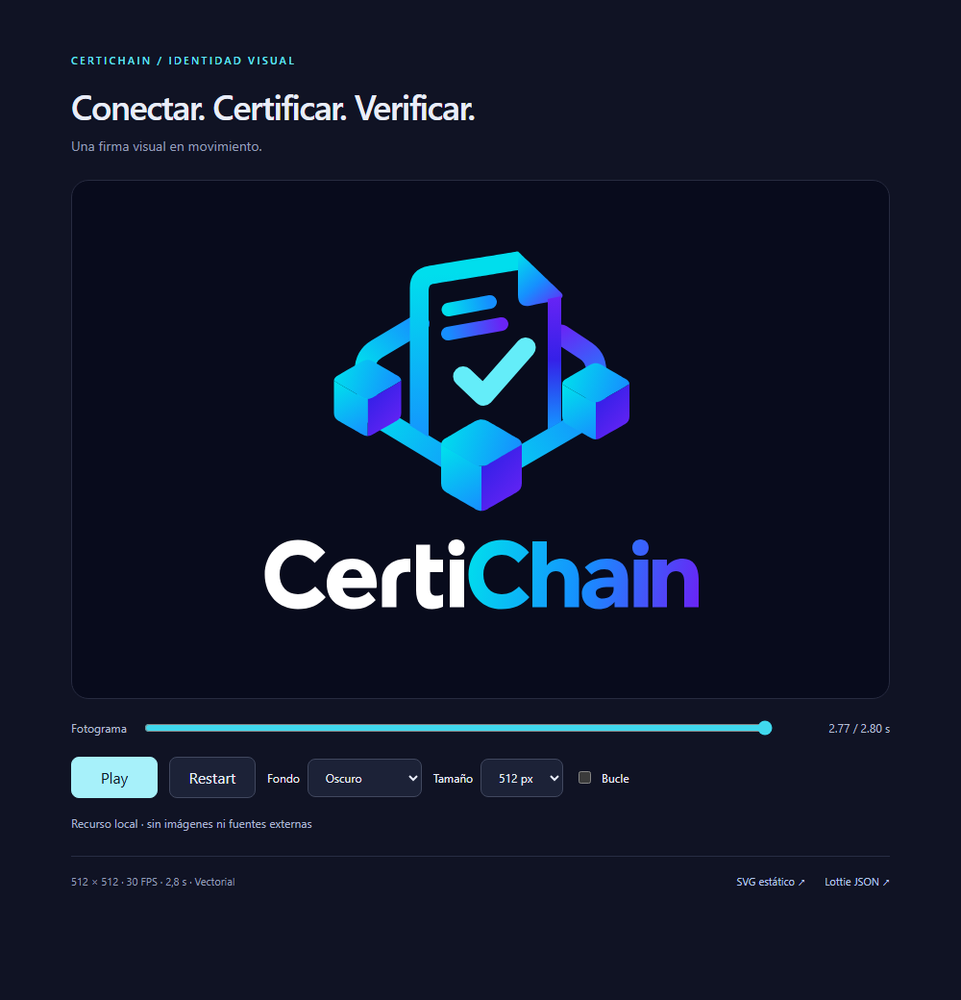
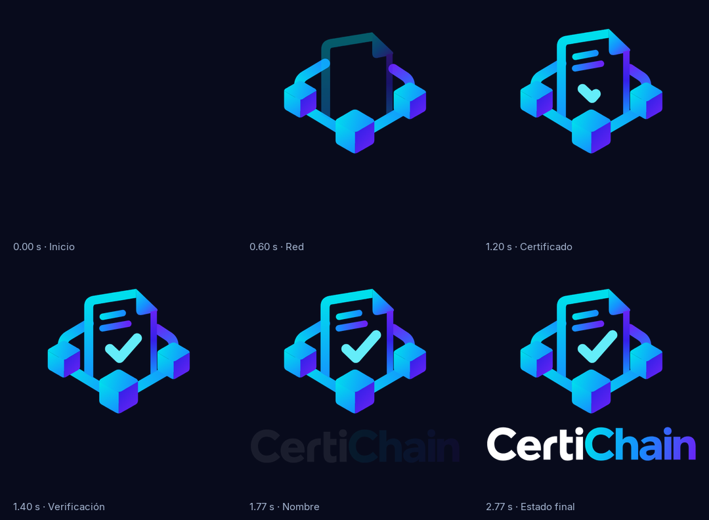

# CertiChain — identidad visual animada

Animación original de **2,8 s, 30 FPS y 512 × 512**, con fondo transparente,
11 capas vectoriales y sin recursos externos. El Lottie pesa **26.182 bytes**.
El estado final permanece visible; el reproductor debe usar `loop: false`.


## Alcance e inspección

La referencia visual es [CertiChainLogo.png](../assets/CertiChainLogo.png), que se
conserva intacta. Se reconstruyeron manualmente sus curvas: tres cubos con caras
independientes, conexiones, documento con borde superior inclinado y esquina
doblada, dos líneas interiores, check y letras. Se limpiaron los residuos de
transparencia/brillo del interior del documento. No se hizo un autotrace del PNG. Los bordes del documento son contornos cerrados: el pliegue y las bases terminan a ras, sin salientes de extremos redondeados. El enlace derecho queda oculto tras el borde correspondiente.

Las letras son contornos Bézier propios basados en la referencia, con la misma
capitalización **CertiChain**, peso y proporciones aproximadas. `Certi` es blanco;
`Chain` tiene un degradado continuo cian–azul–violeta. No se sustituye la marca por
una fuente del sistema ni se distribuye una fuente nueva. Inter, ya presente en
el repositorio, se usa solo en los rótulos de la hoja de capturas.

Se consultaron las referencias de
[Logo Animation](https://lottiefiles.com/free-animation/logo-animation-T5aQXzutOr),
[carbon intro](https://lottiefiles.com/free-animation/carbon-intro-animation-Jtgn5YF2Wo),
[Logo intro](https://lottiefiles.com/free-animation/logo-intro-WLUiwHfCRT) y
[Blockchain](https://lottiefiles.com/animation/blockchain-animation_4560452).
Son referencias de intención visual; no se incorporó ninguno de sus recursos o
secuencias al proyecto. La coreografía sigue las etapas solicitadas para CertiChain.

Se leyeron `AGENTS.md`, `ARCHITECTURE.md`, `FLUTTER_ARCHITECTURE.md` y
`FLUTTER_UI_FOUNDATIONS.md`. Graphify estaba instalado, pero no había un grafo
consultable; `graphify update . --no-cluster` generó el índice AST y
`graphify query "CertiChainBootstrap CertiChainApp AppRouter WelcomeScreen navigation dependencies"`
identificó el arranque y sus dependencias. La extracción avisó de SQL sin parser
y de un header Linux parcial; no afectan a este trabajo de identidad visual.

El arranque está en `mobile/lib/main.dart`; `CertiChainApp` compone las áreas
pública/privada y `AppRouter` lleva a `WelcomeScreen`. El widget existente
`CertiChainLogo` usa un `CustomPainter` y la app no tiene una dependencia Lottie.
Esta entrega añade los recursos y la documentación para consumirlos. No cambia
pantallas, navegación, autenticación, certificados, backend, SQL ni contratos.
Tampoco añade dependencias Dart ni registra un asset que la app aún no utiliza.

## Fuente y archivos

| Archivo | Función |
|---|---|
| `tools/branding/generate_certichain_lottie.py` | Geometría original, keyframes y generador determinista, solo biblioteca estándar |
| `assets/branding/certichain-logo.svg` | Estado final vectorial generado desde la misma geometría |
| `mobile/assets/animations/certichain_intro.json` | Lottie listo para un reproductor local |
| `tools/branding/render_lottie.mjs` | Servidor limitado a branding, reproducción en Chrome y capturas con lottie-web |
| `tools/branding/export_gif.py` | Codifica exclusivamente las capturas del Lottie como GIF y WebP |
| `tools/branding/prepare_validation.py` | Descarga y verifica por SHA-256 el esquema oficial versionado |
| `tools/branding/test_branding.py` | Pruebas de geometría, formato, renderizado y GIF |
| `docs/branding/preview.html`, `.css`, `.js` | Vista previa local con controles |
| `docs/assets/certichain_intro.gif` | GIF 600 × 600, transparente, en bucle; utilizado por el README |
| `docs/assets/certichain_intro.webp` | Versión animada lossless opcional |
| `docs/assets/certichain_intro_keyframes.png` | Momentos principales renderizados por lottie-web |
| `docs/assets/certichain_intro_preview.png` | Captura real de la página en Chrome |

JSON y SVG son archivos generados: modificar el generador y regenerar, nunca
editar sus salidas manualmente. Las capturas intermedias y el informe de ejecución
se guardan en `tools/branding/.render/`, ignorado por Git. El PNG oficial no se duplica.

## Capas y tiempos

Las capas Lottie son `ty: 4` (shapes), en orden de apilado de delante hacia atrás.
No hay máscaras de imagen, efectos, expresiones, texto dependiente de fuentes ni
precomposiciones externas. Los trazos usan extremos y uniones redondeados.

| Etapa | Tiempo | Fotogramas a 30 FPS | Movimiento |
|---|---|---|---|
| Red | 0–0,60 s | 0–18 | Dos capas de enlaces con Trim Paths; convergen en los nodos |
| Cubos | 0,12–0,60 s | 3,6–18 | Tres capas escalonadas; opacidad y escala 91 → 100 %, sin deformación |
| Certificado | 0,45–1,05 s | 13,5–31,5 | Una capa de bordes y pliegue; ascenso de 9 px y escala 97 → 100 % |
| Contenido | 0,80–1,20 s | 24–36 | Dos capas de líneas con revelado progresivo |
| Verificación | 1,05–1,60 s | 31,5–48 | Check abierto de tres vértices y dos segmentos, Trim Paths 0 → 100 % |
| Pulso | 1,60–1,75 s | 48–52,5 | Solo el check: escala 100 → 102,5 → 100 % |
| Nombre | 1,70–2,30 s | 51–69 | Dos capas, `Certi` y `Chain`; opacidad y ascenso de 5 px |
| Reposo | 2,30–2,80 s | 69–84 | Sin cambios de geometría, color u opacidad |

`op: 84` es exclusivo: los 84 fotogramas exportados son 0–83. Se permiten
keyframes fraccionarios. Los marcadores `network`, `document`, `check`,
`wordmark` y `hold` facilitan inspeccionar las fases.

Los gradientes lineales `gf`/`gs` usan stops RGB opacos. La conversión de curvas
cuadráticas a cúbicas es analítica; los tangentes de Lottie son relativos al
vértice. SVG y JSON consumen exactamente esas mismas curvas. La transparencia
del interior del documento forma parte de la composición.

## Parámetros configurables

Al comienzo del generador:

- `DURATION`, `FPS`, `CANVAS`: duración, muestreo y tamaño. La temporización se
  escala proporcionalmente al cambiar la duración; la geometría al cambiar el canvas.
- `COLORS`: paleta. No sustituir el blanco de `Certi` para compensar fondos claros.
- `TIMING`: hitos de cada parte, expresados en segundos de la secuencia base.
- `EASE_OUT`, `EASE_IN`: manejadores Bézier de la interpolación temporal.
- `ART_SCALE`, `ART_OFFSET`: escala y posición del conjunto dentro del canvas.
- `POSITIONS`: centros de los cubos en el espacio de referencia. Si cambia la
  disposición, ajustar también los extremos de los enlaces de `build_animation`.
- `NODE_START_SCALE`, `DOCUMENT_START_SCALE`, `DOCUMENT_RISE`, `WORDMARK_RISE` y
  `CHECK_PULSE_SCALE`: amplitudes del movimiento.

Las coordenadas de los contornos están expresadas en el espacio del PNG de
916 × 916 y agrupadas por componente. `FINAL_PAUSE_MS` en el exportador añade
una pausa de 1.200 ms **solo al GIF/WebP**. Las pruebas de aceptación fijan los
valores solicitados de 512 px, 30 FPS y 2,8 s; actualizar esos contratos si se
decide cambiar la entrega, y volver a revisar las capturas.

## Herramientas y licencias

El generador JSON/SVG solo requiere **Python 3.10+**. No instala nada y funciona
sin conexión. Para la vista previa/exportación:

| Herramienta | Versión utilizada | Motivo y alternativa |
|---|---|---|
| Python | 3.14.4 | Biblioteca estándar para autoría; ningún generador Lottie externo |
| Node.js | 22.14.0 local | Ejecuta el harness CDP existente; también admite el pin 24.14.0 del repo |
| Chrome | 156.0.8078.73 | Navegador ya instalado; `CHROME_EXECUTABLE` permite seleccionar otro compatible |
| [lottie-web](https://github.com/airbnb/lottie-web) | 5.13.0, MIT | Reproductor real requerido; paquete oficial fijado en `package-lock.json` |
| [Pillow](https://pillow.readthedocs.io/en/stable/) | 13.0.0, HPND | Exportación GIF/WebP y comparación de píxeles; evita instalar FFmpeg |
| [jsonschema](https://github.com/python-jsonschema/jsonschema) | 4.26.0, MIT | Valida Draft 2020-12; una comprobación artesanal no sustituye el esquema |

Las dependencias de exportación se aíslan en `tools/branding/.venv` y
`tools/branding/node_modules`. Se verificaron las versiones disponibles y su
funcionamiento local. Pillow y jsonschema tienen publicaciones mantenidas; se
fija la versión de lottie-web para conservar la salida del reproductor. Para
actualizarlas, revisar changelogs/licencias, regenerar y ejecutar la misma suite.

Se reutiliza `mobile/tool/browser_harness.mjs` para lanzar/detener Chrome y hablar
CDP. No se añadió Playwright ni otra biblioteca de automatización. No había
FFmpeg disponible y no es necesario. La biblioteca estándar de Python no incluye
un codificador GIF equivalente a Pillow. El SDK Flutter tampoco reproduce
Lottie directamente; su futura integración necesita un reproductor.

## Preparación y regeneración

Comandos PowerShell, desde la raíz del repositorio:

```powershell
# Solo JSON y SVG: sin dependencias ni acceso de red.
python tools/branding/generate_certichain_lottie.py
python tools/branding/generate_certichain_lottie.py --check

# Preparación única para exportar y validar.
python -m venv tools/branding/.venv
tools/branding/.venv/Scripts/python.exe -m pip install -r tools/branding/requirements.txt
Push-Location tools/branding
npm.cmd ci --ignore-scripts
Pop-Location
python tools/branding/prepare_validation.py

# Renderiza el JSON definitivo y genera GIF, WebP y capturas.
$env:CERTICHAIN_TEST_CAMERA = '0'
tools/branding/.venv/Scripts/python.exe tools/branding/export_gif.py

# Ejecuta las pruebas sobre esos resultados.
tools/branding/.venv/Scripts/python.exe -m unittest discover -s tools/branding -p 'test_*.py' -v
```

En Linux/macOS, usar `tools/branding/.venv/bin/python` y `npm` en lugar de las
rutas de Windows. El harness ya detecta Chrome en esas plataformas; no se han
ejecutado aquí. Para seleccionar una instalación de Chrome distinta:

```powershell
$env:CHROME_EXECUTABLE = 'C:/ruta/a/chrome.exe'
```

`prepare_validation.py` almacena el
[esquema oficial 1.0.1](https://lottie.github.io/lottie-spec/1.0.1/lottie.schema.json)
en `.render` y verifica su SHA-256:
`a6adf87565bfbc94c73b1a5310569fbe53dd7d54df0060dada00559c2a030296`.
Las instalaciones y esa primera descarga requieren red. A partir de entonces,
generación, vista previa, exportación y tests funcionan sin conexión.

Para recodificar sin volver a abrir Chrome:

```powershell
tools/branding/.venv/Scripts/python.exe tools/branding/export_gif.py --skip-render
```

Este modo rechaza capturas cuyo SHA-256 no corresponda al JSON actual. Para
actualizaciones del código de la vista previa o del reproductor, ejecutar la
exportación completa. JSON y SVG son idénticos byte a byte al regenerar; los
binarios raster son reproducibles con las mismas versiones de Chrome/Pillow,
pero pueden variar por antialiasing entre navegadores o sistemas operativos.

El GIF usa 255 colores y un indice transparente. Se exporta desde capturas
RGBA del Lottie sin un fondo fijo, para evitar halos oscuros. GIF admite alpha
binario: valores menores de 128 se vuelven transparentes; el resto, opacos.
El WebP conserva alpha completo y bordes suavizados. `disposal=2` limpia cada
fotograma para evitar rastros. Las capturas de la guia mantienen el fondo oscuro.
El ciclo dura 4.000 ms, con 1.700 ms mostrando el logo completo al final.


## Vista previa local

```powershell
node tools/branding/render_lottie.mjs --serve
```

Abrir [la vista previa](http://127.0.0.1:8787/docs/branding/preview.html).
El servidor escucha solo en `127.0.0.1` y sirve una lista cerrada de archivos de
branding. `Ctrl+C` lo detiene. No abrir el HTML con `file://`: la carga del JSON
requiere HTTP por las restricciones del navegador.

Incluye autoplay, Play/Pause, Restart, control de fotograma, bucle opcional,
fondos oscuro/claro/transparente y tamaños 160/256/512/600 px. El damero es una
ayuda de la página, no parte del JSON. Con `prefers-reduced-motion`, comienza
en el estado final y el usuario puede activar Play. Si falta lottie-web o falla
la carga, muestra un mensaje y el comando necesario.



## Importar a LottieFiles

En una sesión propia de LottieFiles, abrir su función de subida/vista previa y
seleccionar `mobile/assets/animations/certichain_intro.json`. El archivo es
autocontenido: no hay que adjuntar imágenes o fuentes. Revisar el final con
bucle desactivado y los mismos puntos de la hoja de capturas. Guardar/publicar
es opcional; la app y la vista previa local no dependen de LottieFiles.

No se subió ni publicó un recurso en la cuenta del usuario. La compatibilidad
comprobada es con lottie-web y el esquema oficial; la interfaz del editor de
LottieFiles no se ha validado en una cuenta autenticada.

## Utilizar desde Flutter

Esta entrega no cambia `pubspec.yaml` ni el arranque. Para integrarla en una
tarea de UI posterior, evaluar y fijar una versión del
[paquete lottie](https://pub.dev/packages/lottie), revisar su licencia y añadir
el recurso al manifiesto:

```yaml
flutter:
  assets:
    - assets/animations/certichain_intro.json
```

En un widget de presentación:

```dart
import 'package:flutter/material.dart';
import 'package:lottie/lottie.dart';

class CertiChainIntro extends StatelessWidget {
  const CertiChainIntro({super.key, this.size = 280});

  final double size;

  @override
  Widget build(BuildContext context) {
    final reduceMotion = MediaQuery.disableAnimationsOf(context);
    return Semantics(
      label: 'Logotipo de CertiChain',
      image: true,
      child: ExcludeSemantics(
        child: ColoredBox(
          color: const Color(0xFF080B1C),
          child: Lottie.asset(
            'assets/animations/certichain_intro.json',
            width: size,
            height: size,
            fit: BoxFit.contain,
            repeat: false,
            animate: !reduceMotion,
            controller: reduceMotion
                ? const AlwaysStoppedAnimation<double>(1)
                : null,
            errorBuilder: (_, error, stackTrace) => const SizedBox(
              height: 100,
              child: Center(
                child: Text('CertiChain', style: TextStyle(color: Colors.white)),
              ),
            ),
          ),
        ),
      ),
    );
  }
}
```

El ejemplo es una guía de integración, **no código compilado ni probado en esta
entrega**. Para una intro con navegación posterior, utilizar el final del
`AnimationController`, tratar `dispose` y evitar reiniciar la animación con
cambios de sesión. No bloquear enlaces de verificación pública ni usar el check
decorativo como estado real de validez de un certificado. La lógica de Auth y
negocio debe seguir fuera de este widget.

## Validación realizada

Revisión local del **30 de octubre de 2026**, sin pruebas de cámara.

| Comprobación | Resultado |
|---|---|
| Suite Python | **16/16 PASS**: determinismo, geometría, trim, gradientes, nombres, referencias, esquema, render y GIF |
| Esquema oficial Lottie 1.0.1 / Draft 2020-12 | **PASS**, cero errores |
| JSON | **26.182 bytes**, 11 capas, sin assets externos, 84 frames a 30 FPS |
| Reproducción real Chrome + lottie-web 5.13.0 | **PASS**, avance temporal, Pause, Play, Restart y parada final |
| Dos renderizadores | **PASS**, SVG y Canvas: diferencia media máxima por canal <0,2/255 |
| SVG estático frente al último frame Lottie | **PASS**, diferencia media máxima por canal <0,2/255 |
| Primer frame / recortes | **PASS**, alpha vacío al inicio; 84 frames dentro de márgenes |
| Fases | **PASS**, check crece siguiendo su recorrido; nombre ausente antes de su etapa |
| Reposo | **PASS**, frames 69–83 idénticos píxel a píxel |
| Sin red | **PASS**, frame final idéntico con red desactivada; sin peticiones externas del contenido |
| Controles visuales | **PASS**, 160/256/512/600 px y fondos oscuro, claro y damero |
| GIF decodificado | **PASS**, 67 frames almacenados, 600 × 600, 894.870 bytes, bucle infinito, fondo transparente |
| Pausa GIF | **PASS**, último frame 1.700 ms; ciclo total 4.000 ms |
| WebP opcional | Generado lossless, 744.902 bytes; GIF es el recurso elegido para GitHub |
| Revisión visual | Capturas del inicio, red, documento, check parcial, nombre y final; corregida una conexión que atravesaba el documento |
| Formato/análisis | Ruff 0.17.3, Prettier 3.6.2, `node --check`, `git diff --check` |



No se ejecutaron suites Flutter/backend/blockchain porque no se modifica su
código ni configuración. No se ha medido rendimiento en Android físico ni
comparado un render del paquete Flutter. Ese ensayo sigue siendo necesario
antes de activar la intro en la app. La carga en la web de GitHub no se comprobó
remotamente: el README referencia el GIF local comprobado, con una etiqueta
`img`, texto alternativo y enlace al SVG estático.

Cámara: **NOT_RUN — Omitidas por instrucción del usuario; no hay cámara física disponible**.
El harness fija `CERTICHAIN_TEST_CAMERA=0`; no hay captura, permisos, escáner ni
probes de cámara en estas pruebas.

## Límites y mantenimiento

- La reconstrucción limpia conserva la identidad y proporciones, pero no
  pretende igualdad píxel a píxel con los artefactos del PNG. El archivo original
  sigue siendo la referencia de marca.
- `Certi` blanco pierde contraste sobre fondo claro. La opción clara permite
  detectar este límite; el fondo oscuro es el recomendado para esta variante.
- Se comprobó el texto completo a 160 px. Por debajo de ese tamaño conviene usar
  el símbolo sin nombre, lo cual requeriría una variante específica.
- El check tiene un único pulso sutil, sin blur, partículas o destellos. No se
  añade glow rasterizado para imitar el ruido de la imagen de origen.
- El esquema oficial define un subconjunto del formato y no sustituye la
  validación de cada reproductor. Ver [especificación](https://lottie.github.io/lottie-spec/1.0.1/)
  y [documentación de shapes](https://lottiefiles.github.io/lottie-docs/shapes/).
- Tras modificar contornos, paleta, keyframes o dependencias, regenerar JSON/SVG,
  volver a renderizar, ejecutar las pruebas y revisar la hoja de capturas.
  Las comprobaciones automáticas no juzgan por sí solas la fidelidad de marca.
- No cambia ninguna decisión estructural de la aplicación y no requiere un ADR.
